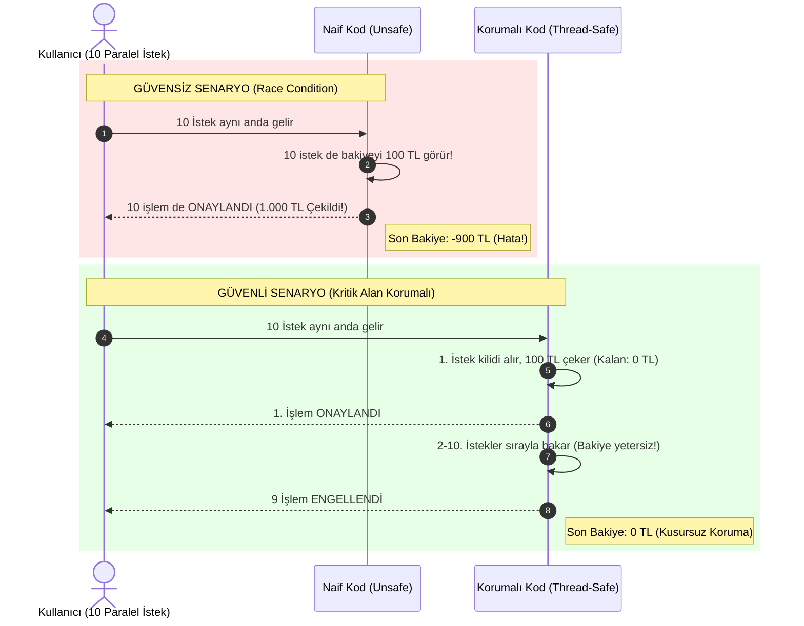

# Race Condition & Double-Spend Simulation in C# .NET


Bu repo, finans, bankacılık ve e-ticaret sistemlerinin en kritik güvenlik/tutarlılık açıklarından biri olan **Race Condition (Yarış Durumu) ve Çift Harcama (Double-Spend)** problemini canlı bir simülasyonla ortaya koymakta ve modern .NET teknikleriyle nasıl çözüleceğini göstermektedir.

---

## 📌 Senaryo Nedir?

* Bir kullanıcının cüzdanında yalnızca **100 TL** bakiye bulunmaktadır.
* Kullanıcı aynı milisaniyede (örneğin "Öde" butonuna arka arkaya basarak veya paralel API istekleriyle) **10 farklı işlemle 100'er TL** çekmeye çalışır.

### ❌ 1. Hatalı Yaklaşım: Naif "Check-Then-Act" (Güvensiz)
Geleneksel ve hatalı kod:
```csharp
if (Balance >= amount) // 1. Kontrol (Check)
{
    await Task.Delay(20); // I/O / DB gecikmesi
    Balance -= amount;     // 2. Eylem (Act)
    return true;
}
```
* **Sorun:** 10 thread de aynı anda `Balance >= 100` şartını kontrol eder. Bakiye henüz düşülmediği için 10 istek de `true` alır!
* **Sonuç:** Kullanıcı 100 TL ile kasadan **1.000 TL** çeker, bakiye eksiye (**-900 TL**) düşer!

### ✅ 2. Güvenli Yaklaşım: Eşzamanlılık Korumalı Kritik Alan (Safe)
Kontrol ve bakiye düşüm işlemi atomik bir blok (Critical Section) haline getirilir:
```csharp
await _lock.WaitAsync();
try
{
    if (Balance >= amount)
    {
        await Task.Delay(20);
        Balance -= amount;
        return true;
    }
    return false;
}
finally
{
    _lock.Release();
}
```
* **Sonuç:** İlk gelen işlem 100 TL'yi çeker ve bakiyeyi 0 yapar. Kalan 9 işlem güvenli şekilde reddedilir. Kasa kuruşu kuruşuna korunur!

---

## 🔄 Akış Şeması (Mermaid Sequence Diagram)



---

## 🚀 Nasıl Çalıştırılır?

```bash
git clone https://github.com/EmreSlgr/dotnet-race-condition-double-spend.git
cd dotnet-race-condition-double-spend
dotnet run
```

### Beklenen Konsol Çıktısı

```text
>>> 1. SENARYO ÇALIŞTIRILIYOR: Güvensiz (Thread-Unsafe) Banka Hesabı
  [İşlem #01] 100 TL Çekildi! (Kalan Bakiye: -200 TL)
  [İşlem #02] 100 TL Çekildi! (Kalan Bakiye: -300 TL)
  ...
  [KRİTİK GÜVENLİK AÇIĞI TESPİT EDİLDİ - FAIL]
  * Başlangıç Bakiyesi     : 100 TL
  * Başarılı İşlem Sayısı  : 10/10
  * Son Bakiye             : -600 TL (Çift Harcama Felaketi!)

--------------------------------------------------------------------------

>>> 2. SENARYO ÇALIŞTIRILIYOR: Eşzamanlılık Korumalı (Thread-Safe) Banka Hesabı
  [İşlem #01] 100 TL Çekildi! (Kalan Bakiye: 0 TL) -> ONAYLANDI
  [İşlem #02] Yetersiz Bakiye! İşlem güvenli şekilde ENGELLENDİ.
  ...
  [KUSURSUZ KORUMA - SUCCESS]
  * Başlangıç Bakiyesi     : 100 TL
  * Başarılı İşlem Sayısı  : 1/10
  * Engellenen İşlem Sayısı: 9/10
  * Son Bakiye             : 0 TL (Bakiye tam korundu.)
```

---

## 💡 Dağıtık Sistemlerde / Veritabanı Seviyesinde Çözüm

Bellek içi kilitler (`SemaphoreSlim`, `lock`) tek bir sunucu/instance için geçerlidir. Mikroservis veya birden fazla sunucu (Load Balancer) arkasındaki sistemlerde şu yöntemler kullanılır:

1. **Atomik SQL Güncellemesi (Tavsiye Edilen):**
   ```sql
   UPDATE Accounts 
   SET Balance = Balance - @amount 
   WHERE Id = @accountId AND Balance >= @amount;
   ```
   *Eğer etkilenen satır sayısı (`RowsAffected`) 0 ise, bakiye yetersizdir.*
2. **EF Core Optimistic Concurrency:**
   * Entity üzerine `[ConcurrencyCheck]` veya `RowVersion` (Timestamp) eklenerek çakışma durumunda `DbUpdateConcurrencyException` fırlatılması sağlanır.
3. **Dağıtık Kilit (Distributed Lock):**
   * Redis `RedLock` mekanizması ile hesap bazlı kilit açılır.

---

## 👨‍💻 Geliştirici
* **Emre Salgır** - [GitHub Profilim](https://github.com/EmreSlgr)
